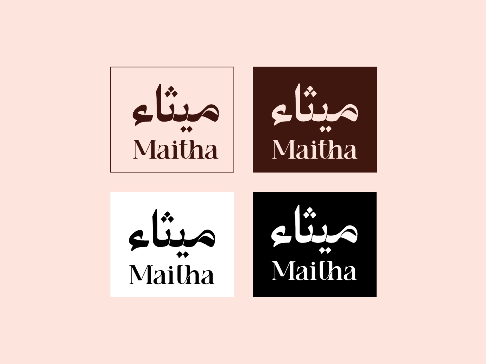
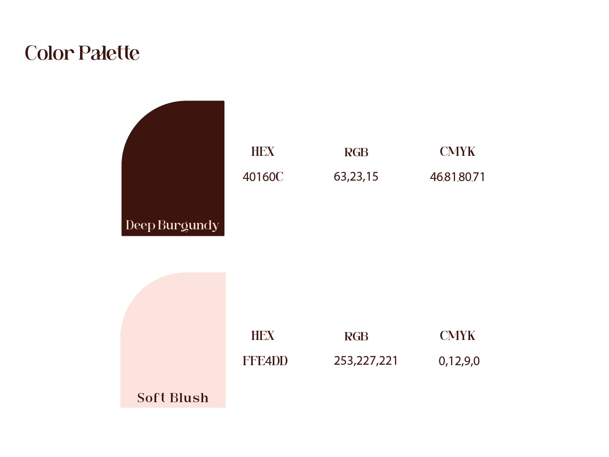
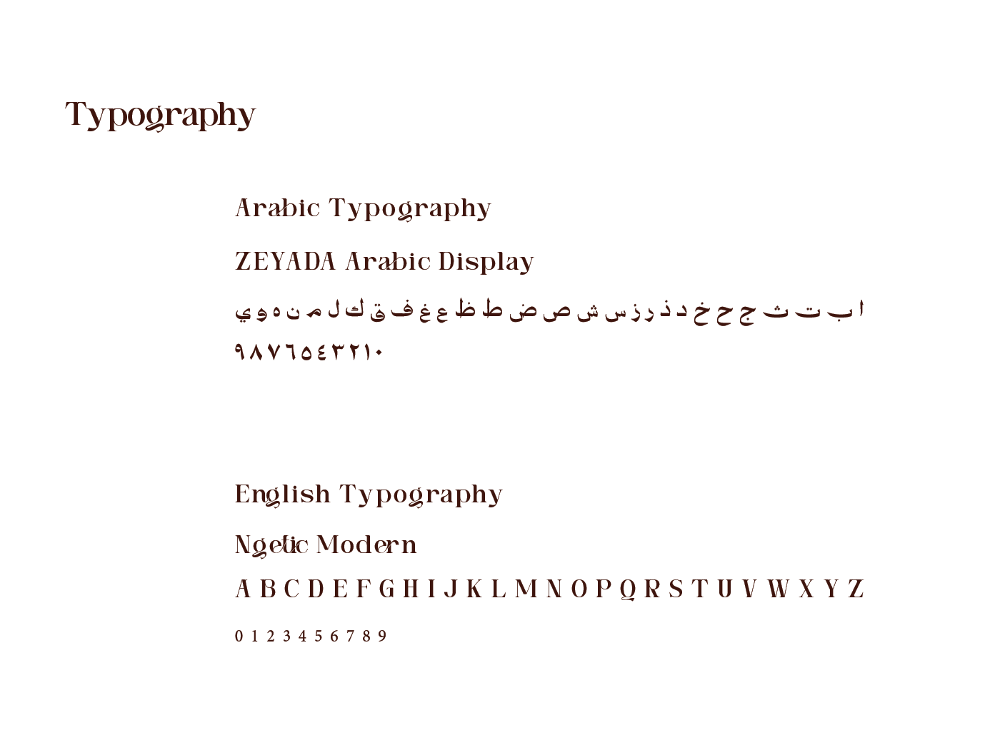
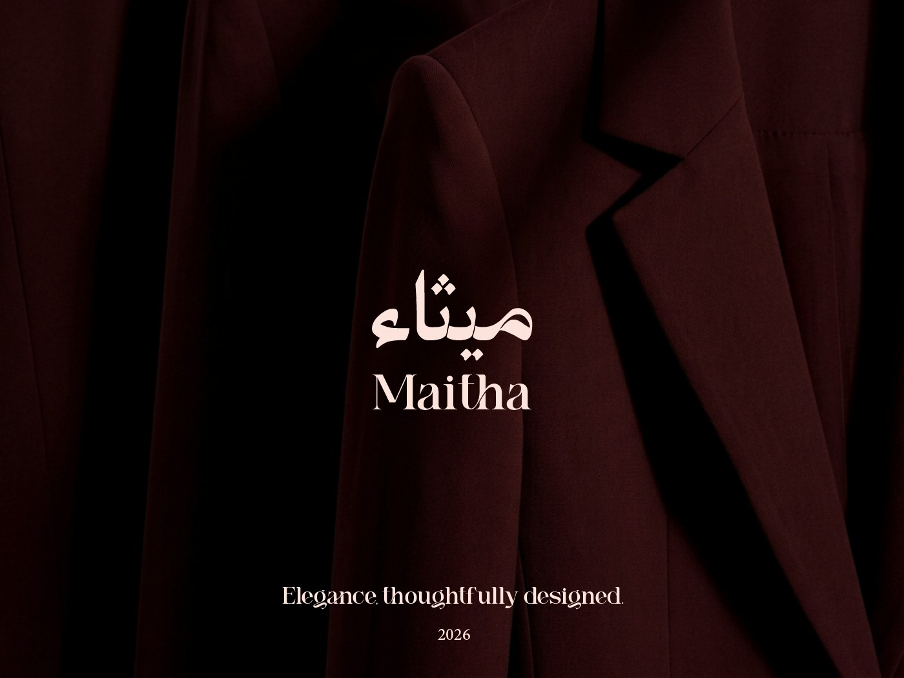
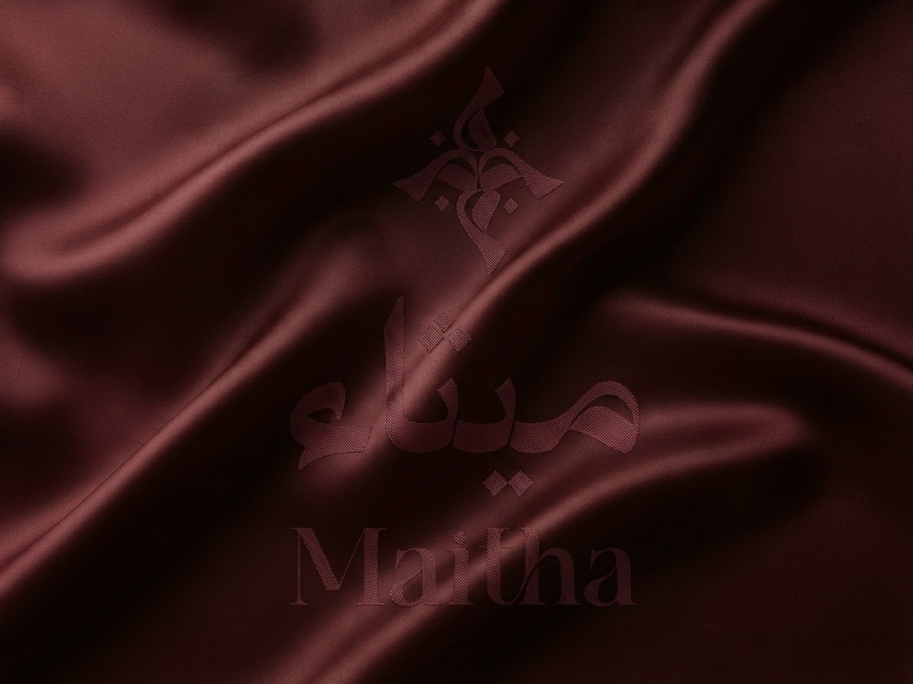
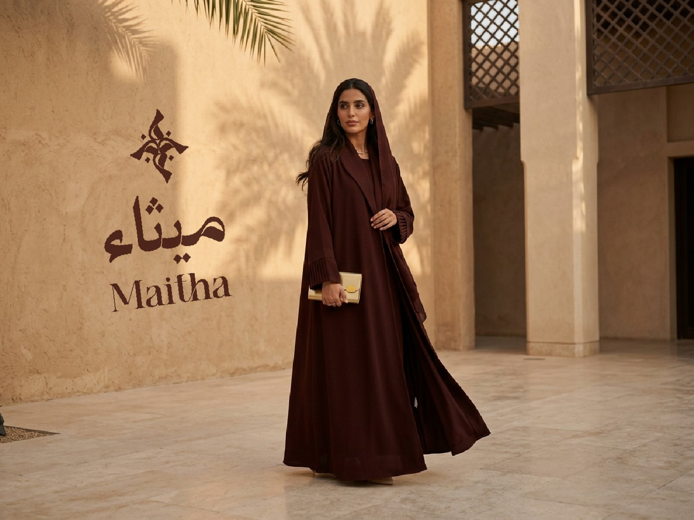
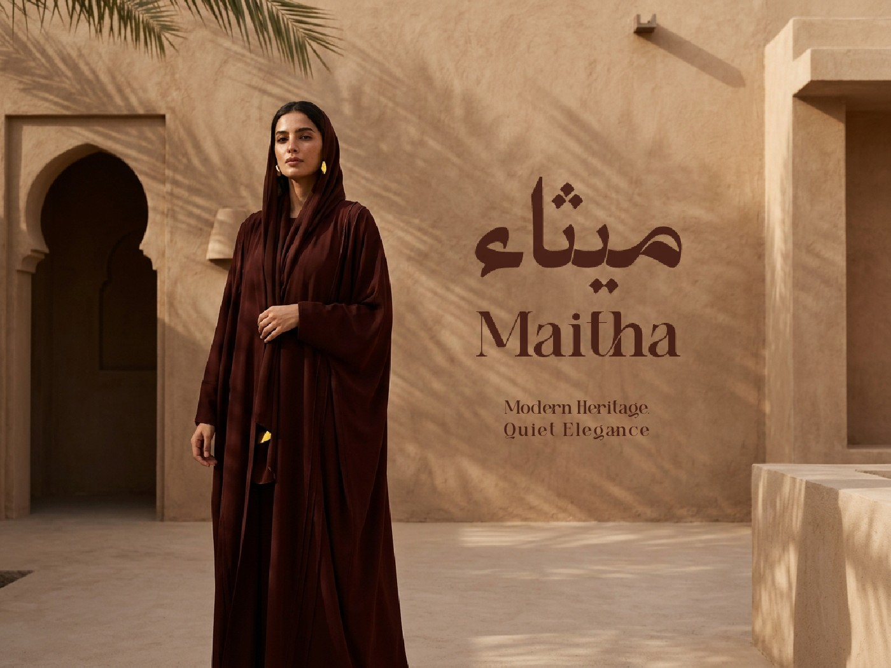
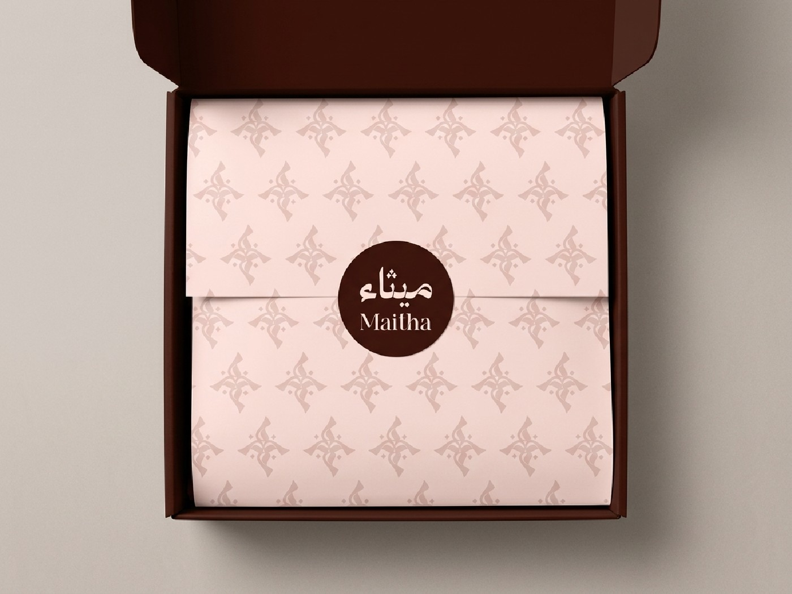
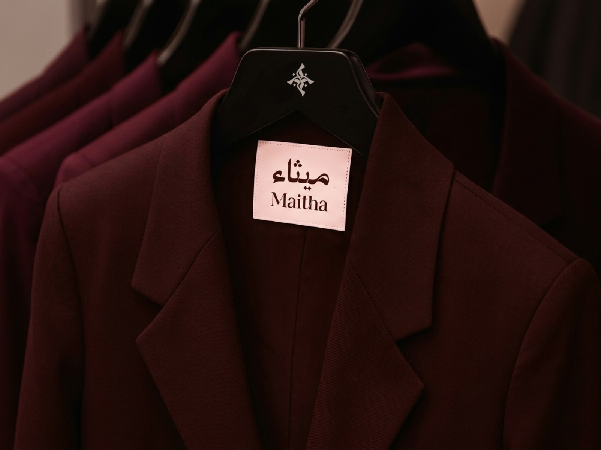
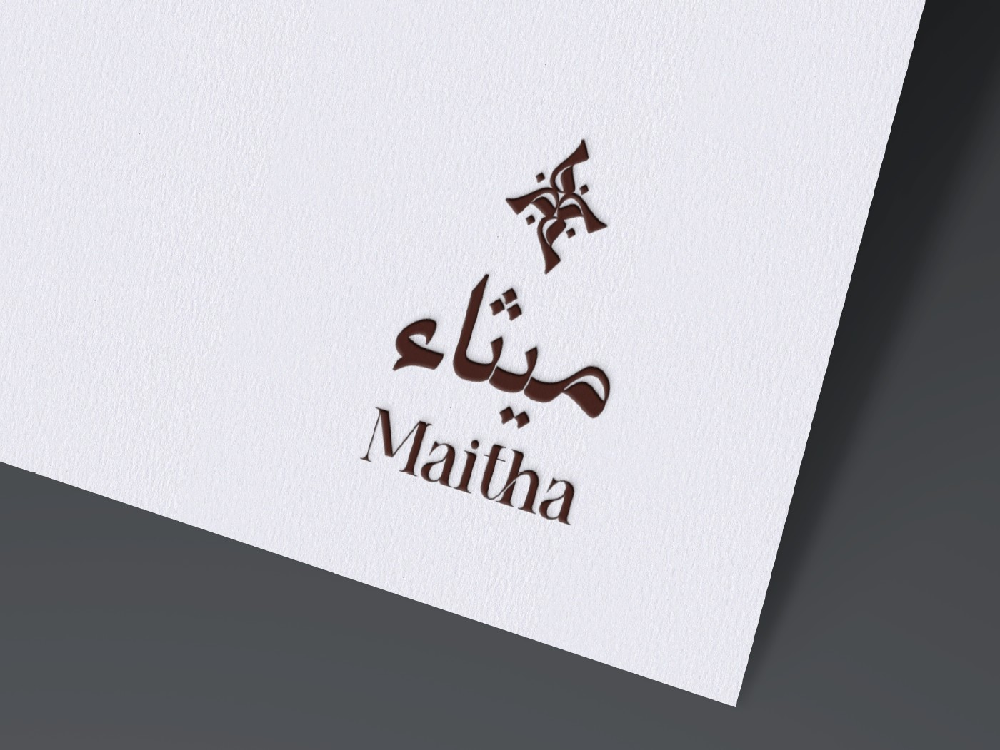

# Maitha — Brand Identity

A visual identity for Maitha (ميثاء), a contemporary women's abaya brand built around quiet elegance and modern Arab heritage.

| | |
|---|---|
| **Project** | Brand Identity, Packaging |
| **Brand** | Maitha (ميثاء) |
| **Industry** | Women's fashion, abayas |
| **Audience** | Women 25 to 40 |
| **Scope** | Bilingual logo, color palette, typography, pattern, packaging, thank-you card, clothing tag, stickers, brand guidelines |

## Idea

The name Maitha is classic and calm without feeling dated. The identity follows the same line: a bilingual Arabic and English wordmark with a small ornamental mark, a deep burgundy paired with a soft blush, and a repeating pattern drawn from the mark for packaging and wrapping.

## Logo

## Color and Typography

 

| Color | HEX | RGB |
|---|---|---|
| Deep Burgundy | #40160C | 63, 23, 15 |
| Soft Blush | #FFE4DD | 253, 227, 221 |

Arabic: ZEYADA Arabic Display. English: Ngetic Modern.

## Applications

 

 

 

## More work

Behance: https://www.behance.net/wejdan_design_

© Wejdan Abdulaziz. All rights reserved.
